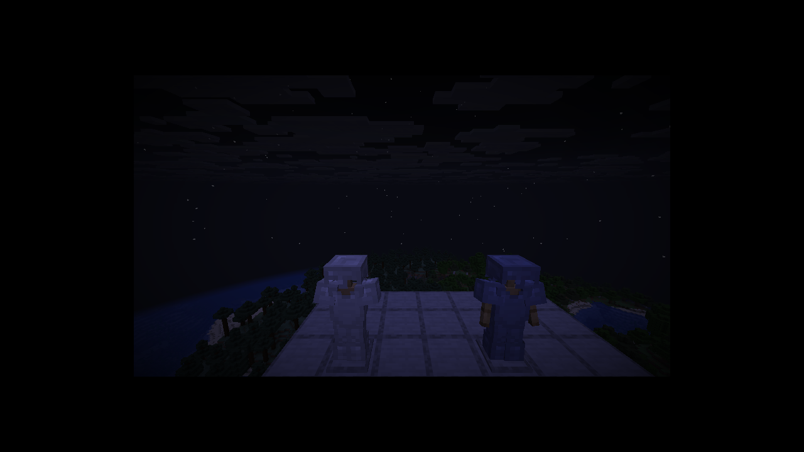

# FactoryCraft

[](https://github.com/Draxer21/FactoriaCraft/actions/workflows/build.yml)

FactoryCraft es un mod tecnológico para Minecraft que convierte la construcción de una fábrica en una experiencia de producción, transporte y gestión de recursos. Añade maquinaria industrial, vehículos de trabajo, redes de energía y almacenamiento, nuevos materiales y sistemas de progresión.

El mod incluye un **manual dentro del juego** en español e inglés con recetas, controles y explicaciones de las máquinas.

## Descargas y capturas

[Descargar la última versión publicada](https://github.com/Draxer21/FactoriaCraft/releases/latest) · [Ver todas las capturas automáticas](https://github.com/Draxer21/FactoriaCraft/tree/ci-screens)



## Características

- **Herramientas:** martillos para minería en área, taladros y motosierras en varios niveles, además de equipo industrial especializado.
- **Minería y procesamiento:** nuevos minerales y aleaciones, trituradoras, hornos industriales, lavadoras, prensas, mezcladoras, ensambladoras y otras máquinas.
- **Vehículos de trabajo:** excavadoras, tuneladoras, camiones, aplanadoras, cosechadoras, bulldozers, grúas, locomotoras, helicópteros y submarinos.
- **Automatización y logística:** cintas transportadoras, clasificadores, elevadores, brazos robóticos, tuberías, estaciones de carga, drones y redes de almacenamiento conectadas por cables de datos.
- **Energía:** generadores de combustible, solares, eólicos, hidroeléctricos, geotérmicos y nucleares, además de baterías, cables y mejoras para máquinas.
- **Granjas y fluidos:** invernaderos, plantación y cosecha automatizadas, bombas, tanques, tratamiento de agua y transporte de líquidos.
- **Progresión y mundo:** investigación para desbloquear tecnología avanzada, aldeanos mecánicos, contratos, economía, estructuras y recursos del Nether y del End.
- **Ambiente y defensa:** contaminación del aire, radiación, purificación, armas y torretas.
- **Final del juego:** tecnología de antimateria y un acelerador de partículas.

## Requisitos

- Minecraft **26.2** con NeoForge **26.2.0.93 o posterior** (rama `main`)
- También hay versiones para Minecraft **26.1** y **26.1.2** (rama `mc-26.1`); cada release indica su versión en el nombre, por ejemplo `v0.33.0-mc26.1.2`
- Java **25**

## Instalación

1. Instala NeoForge para tu versión de Minecraft y ejecuta el juego una vez.
2. Descarga el JAR de FactoryCraft que corresponde a esa versión y cópialo a la carpeta `mods` de tu instancia.
3. Inicia el juego con el perfil de NeoForge.

JEI, Jade y Bonded son opcionales: FactoryCraft incluye compatibilidad con ellos si están instalados. Con Jade puedes mirar una máquina compatible para ver avisos como falta de energía, entradas incompatibles o salida bloqueada.

## Compilar desde el código fuente

Con Java 25 instalado, desde la raíz del repositorio ejecuta:

```powershell
.\gradlew.bat build
```

El JAR se genera en `build/libs/`. Para iniciar el cliente de desarrollo:

```powershell
.\gradlew.bat runClient
```

## Licencia

La configuración del mod declara la licencia como **All Rights Reserved**. El repositorio no incluye un archivo de licencia que otorgue permisos adicionales.
